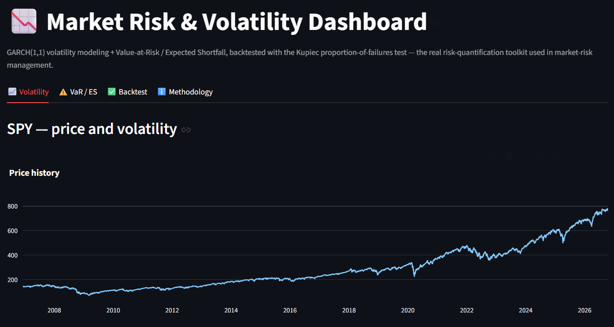
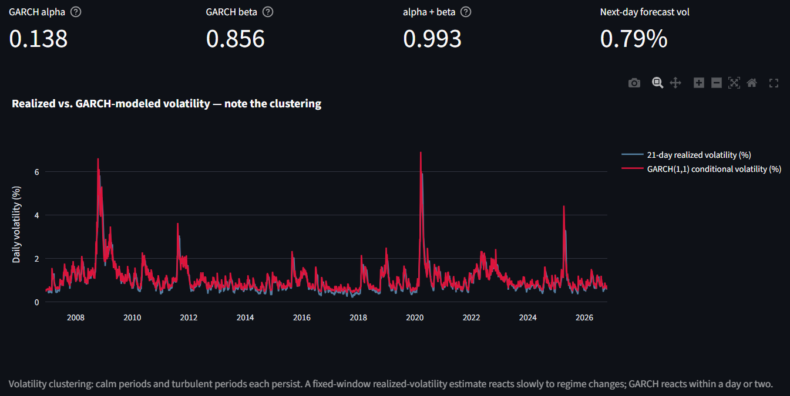
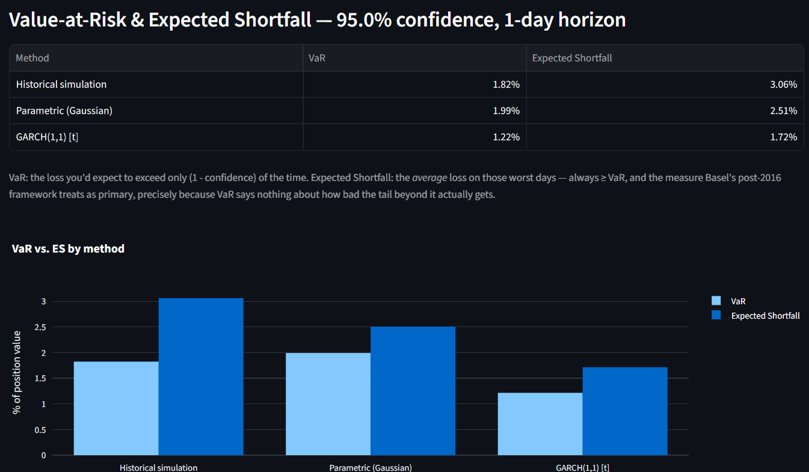
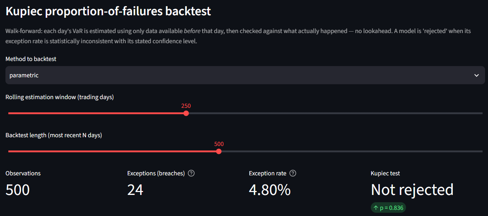
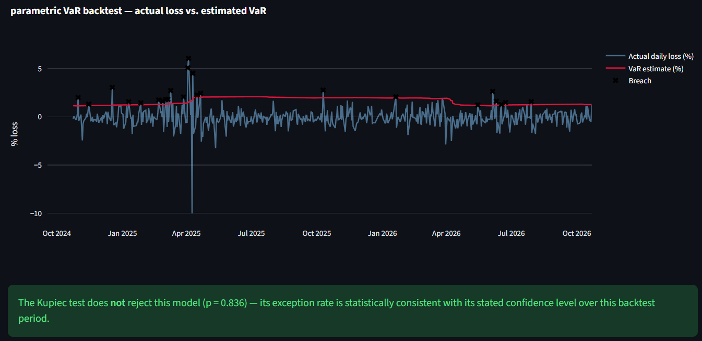

<div align="center">

# 📉 Market Risk & Volatility Dashboard

**How much could this position lose tomorrow, and was yesterday's estimate honest?**
GARCH volatility, Value-at-Risk and Expected Shortfall three ways, and a walk-forward Kupiec backtest, on live
prices for any stock, ETF, crypto pair or currency.


</div>

| | |
|---|---|
|  |  |
|  |  |


<sub>The backtest screenshot was taken before the breach markers were recoloured from black to orange for dark mode.</sub>

---

## The problem

Every bank, fund and clearing house has to state how much it could lose on a bad day (**Value-at-Risk**) and how bad
the days beyond that get (**Expected Shortfall**). Under the Basel market-risk rules a model is only trusted after it
has been **backtested**: its estimates are compared with what actually happened, day by day. A risk number nobody
has checked against reality is decoration.

Two things make it hard. Volatility is not constant: calm and stormy periods each last for weeks, so a VaR built on
a long-run average is too high in calm times and far too low when a crisis starts. And real returns have fat tails,
so a normal-distribution VaR understates the worst days. This dashboard measures both effects and then tests the
estimates honestly.

## Highlights

- **GARCH(1,1) volatility** with Student-t or normal shocks, fitted with Kevin Sheppard's `arch` package and plotted
  against 21-day realised volatility, so volatility clustering is visible.
- **VaR and Expected Shortfall three ways**, side by side: historical simulation, Gaussian, and GARCH (which uses
  *tomorrow's* forecast volatility, so it reacts to the current regime).
- **Walk-forward backtest with no look-ahead:** each day's VaR uses only earlier data, then meets the real return.
  The **Kupiec proportion-of-failures test** says whether the number of breaches fits the stated confidence level.
- **Any Twelve Data symbol:** SPY, QQQ, AAPL, NVDA, BTC/USD, XAU/USD and more, up to about 19 years of daily prices.
- **36 engine checks** against hand-worked values, numerical integration and `arch` itself, plus a mutation check
  (10 of 10 planted bugs caught).

## Results: SPY, 2007 to October 2026

From the screenshots above (daily closes from Twelve Data, 95% confidence, 1-day horizon).

**Volatility.** GARCH(1,1) with Student-t shocks gives alpha = **0.138**, beta = **0.856**, persistence alpha + beta =
**0.993**: a shock fades slowly, with a half-life of about 100 trading days. The conditional volatility tracks the
2008 crisis, the 2020 COVID crash and the April 2025 sell-off, and the next-day forecast was **0.79%**.

| Method | 1-day VaR (95%) | Expected Shortfall (95%) |
|---|---|---|
| Historical simulation | 1.82% | **3.06%** |
| Parametric (Gaussian) | 1.99% | 2.51% |
| GARCH(1,1), Student-t | **1.22%** | 1.72% |

- **Fat tails:** the historical Expected Shortfall (3.06%) is well above the Gaussian one (2.51%). On SPY's worst 5%
  of days, the average loss is about a fifth larger than a normal distribution predicts.
- **Regime:** GARCH's VaR (1.22%) is the lowest because the market was calm when the screenshots were taken. The
  full-sample methods average in 2008 and 2020. If volatility jumps, GARCH's VaR rises within a day or two and the
  others barely move.

**Backtest** (Gaussian VaR, last 500 trading days, 250-day estimation window): **24 breaches in 500 days (4.80%)**
against 25 expected, Kupiec p = **0.836**, so the model is not rejected.

The chart shows why that is not the whole story. Most breaches come in the first six months, up to April 2025, while
the VaR was still low after a calm 2024. Then the April 2025 sell-off (SPY lost about 5% and 6% on two consecutive
days, and rose 10.5% a few days later, the spike below zero) pushed the VaR up to about 2%. The 250-day window kept
it there for a year, long after the market had calmed, and breaches became rare. When the sell-off finally left the
window in spring 2026, the VaR dropped and breaches returned. The breach *count* passes the test; their *timing*
does not look random. That is the known weakness of Kupiec's test (it ignores clustering) and of fixed-window VaR
(it reacts late), and it is what the GARCH method in the app is built to fix. Choose **garch** in the Backtest tab to
compare.

## Quick start

```bash
git clone https://github.com/harshadulshan/market-risk-dashboard.git
cd market-risk-dashboard
python -m venv .venv
.venv\Scripts\activate          # Windows  (macOS/Linux: source .venv/bin/activate)
pip install -r requirements.txt
streamlit run app.py
```

The app needs a **free Twelve Data API key**: sign up at [twelvedata.com](https://twelvedata.com) (no credit card)
and paste it into the sidebar. The free tier allows 800 requests a day and 8 a minute. The key stays in your browser
session and is never written to disk.

Then pick an instrument (or type any symbol), a confidence level (90%, 95%, 97.5% or 99%) and the GARCH shock
distribution. The GARCH backtest refits the model about 100 times (every 5 days over 500 days), so it takes a little longer.

<details>
<summary><b>How it works</b></summary>

**Returns.** Daily log returns, r_t = ln(P_t / P_t-1).

**GARCH(1,1)** (Bollerslev, 1986), zero-mean:

```
sigma²_t = omega + alpha · r²_(t-1) + beta · sigma²_(t-1)
```

`alpha` is the reaction to yesterday's shock, `beta` the memory of yesterday's volatility. Returns are scaled to
percent for the optimiser and the parameters are scaled back, so the recursion reproduces `arch`'s own conditional
volatility to machine precision (a test checks this).

**VaR and Expected Shortfall** at confidence c, tail probability a = 1 − c:

| Method | VaR | Expected Shortfall |
|---|---|---|
| Historical | − (a-quantile of past returns) | − mean of the returns at or below that quantile |
| Gaussian | − (mu + z_a · sigma) | − mu + sigma · phi(z_a) / a |
| GARCH, normal | − z_a · sigma_(t+1) | sigma_(t+1) · phi(z_a) / a |
| GARCH, Student-t (nu) | − t_a · sqrt((nu−2)/nu) · sigma_(t+1) | sigma_(t+1) · sqrt((nu−2)/nu) · f_nu(t_a)/a · (nu + t_a²)/(nu − 1) |

The Student-t is rescaled to unit variance, so sigma keeps meaning "volatility".

**Walk-forward backtest.** For each day t after a window of W days, the model is estimated on days t−W … t−1 and the
day-t return is compared with that VaR. GARCH parameters are re-estimated every 5 days. On the days between, the
parameters are held but the variance is still rolled forward each day with the recursion above, so the forecast
reacts to every new return.

**Kupiec (1995) test.** With x breaches in n days and expected rate p:

```
LR = −2 [ x ln p + (n − x) ln(1 − p) − x ln(x/n) − (n − x) ln(1 − x/n) ]   ~ chi²(1)
```

p < 0.05 rejects the model: too many breaches means it understates risk, too few means it is too conservative.

</details>

## Verification

```bash
python tests/verify_engine.py     # 36 checks, about 20 seconds, no API key or internet needed
```

- **GARCH:** recovers alpha, beta and the t degrees of freedom from 4,000 simulated GARCH days. The returned
  omega/alpha/beta reproduce `arch`'s conditional volatility to about 1e-15, and the next-day forecast equals the
  recursion applied to the last day.
- **VaR / ES:** Gaussian and standardised Student-t ES match numerical integration (rtol 1e-6) at 95% and 99%.
  Historical VaR on 200,000 normal draws lands within 2% of the true value. ES ≥ VaR everywhere.
- **Kupiec:** the LR statistic matches the hand formula. 5 breaches in 250 days at 99% passes, 10 (Basel's red
  zone) is rejected, zero breaches does not crash, and the exact expected rate gives LR = 0.
- **Backtest:** one forecast per day; a correct Gaussian model on Gaussian data breaches 4.6% of days and passes
  Kupiec. Changing future returns leaves every earlier VaR unchanged (no look-ahead). Between refits, the GARCH VaR
  follows the variance recursion exactly and changes every day.

**Mutation check:** 10 bugs were planted one at a time, among them a frozen GARCH forecast between refits, omega left
in percent units, Gaussian ES without the 1/a, an unscaled Student-t, a look-ahead window, breaches counted on gains,
and a Kupiec test with the wrong degrees of freedom. The tests caught all 10.

## Limitations

1. **GARCH(1,1) is the workhorse, not the state of the art.** It treats losses and gains alike. GJR-GARCH or EGARCH
   capture the leverage effect (falls raise volatility more than rises), and portfolios need multivariate models.
2. **Kupiec counts breaches but not when they happen.** Five breaches in a row are worse than five spread over a
   year. Christoffersen's conditional-coverage test checks for that clustering.
3. **One instrument, its own history.** Real model validation covers many instruments, market regimes and
   out-of-time periods, with independent review.
4. **Returns stand in for P&L.** A real desk backtests against the actual profit and loss of its positions.
5. **Parameters are re-estimated every 5 days** in the GARCH backtest, to keep the app interactive. The daily
   variance update between refits keeps the forecasts current.

## Project structure

```
app.py               Streamlit interface: Volatility, VaR / ES, Backtest, Methodology
risk_model.py        GARCH fit, VaR / ES (3 methods), Kupiec test, walk-forward backtest
market_client.py     Twelve Data daily price client
tests/               verify_engine.py (36 offline checks)
docs/screenshots/    the images above
```

## Tech stack

Python · Streamlit · `arch` (GARCH) · SciPy · pandas · NumPy · Plotly · Twelve Data API

<details>
<summary><b>References</b></summary>

- Bollerslev, T. (1986). Generalized autoregressive conditional heteroskedasticity. *Journal of Econometrics* 31(3),
  307-327.
- Kupiec, P. (1995). Techniques for verifying the accuracy of risk measurement models. *Journal of Derivatives* 3(2),
  73-84.
- Christoffersen, P. (1998). Evaluating interval forecasts. *International Economic Review* 39(4), 841-862.
- McNeil, A. J., Frey, R. & Embrechts, P. (2015). *Quantitative Risk Management*, 2nd ed. Princeton University Press
  (Expected Shortfall of the Student-t).
- Basel Committee on Banking Supervision (2019). *Minimum capital requirements for market risk* (Expected Shortfall
  and backtesting).
- Sheppard, K. `arch`: ARCH and other tools for financial econometrics in Python.

</details>

## Author

**Harsha Dulshan** · BSc (Hons) Management Information Systems, NSBM Green University
[GitHub](https://github.com/harshadulshan) · [LinkedIn](https://www.linkedin.com/in/harsha-kaldera/)

## License

MIT. See [LICENSE](LICENSE).
